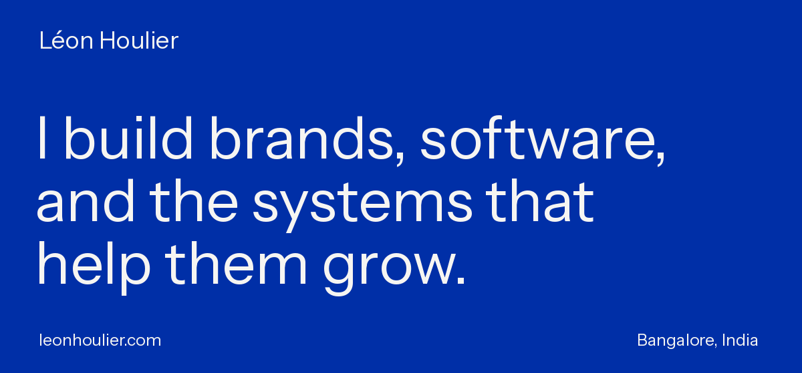
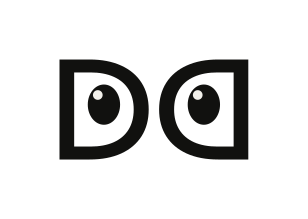
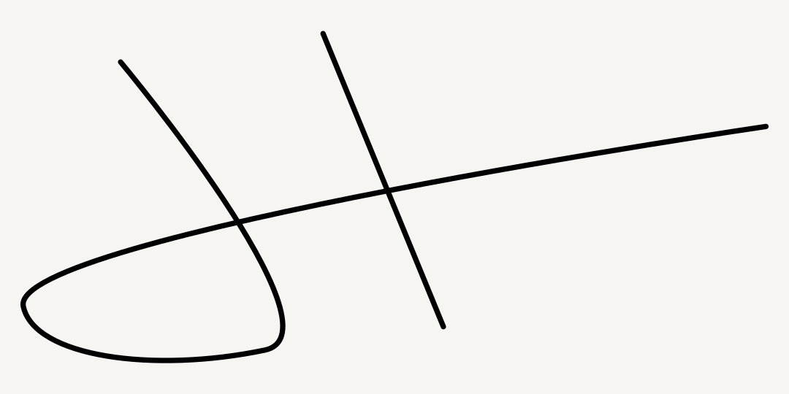

  <a href="https://leonhoulier.com"><strong>MY WEBSITE ↗</strong></a> &nbsp; / &nbsp;
  <a href="https://detail-department.com"><strong>THE AGENCY ↗</strong></a> &nbsp; / &nbsp;
  <a href="https://leonhoulier.com/blog/"><strong>WRITING ↗</strong></a> &nbsp; / &nbsp;
  <a href="https://www.linkedin.com/in/leonhoulier/"><strong>LINKEDIN ↗</strong></a>

## Léon Houlier

I'm Léon. Five years in paid media and adtech at details.ch and Digital Luxury Group. Now in Bangalore, building **[The Detail Department](https://detail-department.com)** and software of my own.

I kept losing track of local servers. That became **Mast**. I wanted AI tools to work with domains, mail and hosting. That's **Infomaniak MCP**. The agency brings the same technical curiosity to campaign operations, measurement and websites for luxury brands.

## Selected work

<table>
<tr>
<td width="50%" valign="top">
<h3>01 / Infomaniak MCP</h3>

Domains, mail and hosting, connected to AI tools. Scoped access and explicit approval for changes.

<strong>OPEN SOURCE · UNOFFICIAL</strong>

<a href="https://infomaniak-mcp.com">Try it ↗</a> · <a href="https://github.com/leonhoulier/infomaniak-ai">Read the code ↗</a>

</td>
<td width="50%" valign="top">
<h3>02 / Mast</h3>

Which project owns port 3000? Repositories, ports, branches and CI, in the Mac menu bar.

<strong>MAC APP · PRIVATE SOURCE</strong>

<a href="https://usemast.sh">Meet Mast ↗</a> · <a href="https://github.com/leonhoulier/mast-releases">Public releases ↗</a>

</td>
</tr>
<tr>
<td width="50%" valign="top">
<h3>03 / WHOOP MCP</h3>

Recovery, sleep, strain and workout data through an MCP server, with OAuth and token refresh.

<strong>EARLIER PROJECT</strong>

<a href="https://github.com/leonhoulier/whoop-mcp-server">Source &amp; setup ↗</a> Initial implementation credited to <a href="https://github.com/ctvidic">ctvidic</a>.

</td>
<td width="50%" valign="top">
<h3>04 / Speed Reader</h3>

A Raycast extension. Selected text, clipboard or a browser page, one word at a time.

<strong>RAYCAST · ADJUSTABLE SPEED</strong>

<a href="https://github.com/leonhoulier/speed-reader">Read the code ↗</a>

</td>
</tr>
</table>

<a href="https://detail-department.com">
  <picture>
    <source media="(prefers-color-scheme: dark)" srcset="assets/department-mark-dark.svg">
    
  </picture>
</a>

## The Detail Department

The execution agency for luxury brands. Campaign operations, measurement, websites and AI implementation. [Explore the agency →](https://detail-department.com)

### Reports from the Department

<table>
<tr>
<td width="50%" valign="top">
<h3>The AI Media Index</h3>

Advertising, design, analytics and automation. What connects to AI, what it can change, and where a person still needs to step in.

<a href="https://detail-department.com/ai-media-index"><strong>Explore the report ↗</strong></a> · <a href="https://github.com/The-Detail-Department/ai-paid-media-tools">Sources ↗</a>

</td>
<td width="50%" valign="top">
<h3>The AI CMS Index</h3>

CMS and commerce platforms for AI-assisted content work. Drafting, editing, publishing, permissions and setup.

<a href="https://detail-department.com/ai-cms-index"><strong>Explore the report ↗</strong></a>

</td>
</tr>
</table>

Published by The Detail Department. Documentation reviewed unless an entry says otherwise; readiness grades are not proof of tested workflows.

## Bangalore, let's build something.

I'm keen to meet frontend and Shopify developers who care about the details: typography, motion, accessibility and fast storefronts. **[Show me something you've made.](mailto:leon@detail-department.com)**

[More projects, writing and the personal story → **leonhoulier.com**](https://leonhoulier.com)

### Kindest, Léon.

Made with Love and AI in Bangalore, India.
