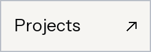
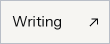
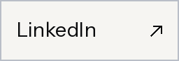
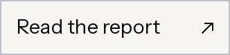

  
  
  
  

Five years in paid media and adtech at details.ch and Digital Luxury Group. Now in Bangalore, building **[The Detail Department](https://detail-department.com)** and software of my own.

## Selected work

<table>
<tr>
<td width="50%" valign="top">
<h3><a href="https://infomaniak-mcp.com">Infomaniak MCP</a></h3>

Domains, mail and hosting, connected to AI tools. Scoped access and explicit approval for changes.

Open source · Unofficial

<a href="https://infomaniak-mcp.com">Setup guide ↗</a> · <a href="https://github.com/leonhoulier/infomaniak-ai">Source code ↗</a>

</td>
<td width="50%" valign="top">
<h3><a href="https://usemast.sh">Mast</a></h3>

Which project owns port 3000? Repositories, ports, branches and CI, in the Mac menu bar.

Mac app · Private source

<a href="https://usemast.sh">Visit Mast ↗</a> · <a href="https://github.com/leonhoulier/mast-releases">Public releases ↗</a>

</td>
</tr>
<tr>
<td width="50%" valign="top">
<h3><a href="https://github.com/leonhoulier/whoop-mcp-server">WHOOP MCP</a></h3>

Recovery, sleep, strain and workout data through an MCP server, with OAuth and token refresh.

Earlier project

<a href="https://github.com/leonhoulier/whoop-mcp-server">Source &amp; setup ↗</a> Initial implementation credited to <a href="https://github.com/ctvidic">ctvidic</a>.

</td>
<td width="50%" valign="top">
<h3><a href="https://github.com/leonhoulier/speed-reader">Speed Reader</a></h3>

A Raycast extension. Selected text, clipboard or a browser page, one word at a time.

Raycast extension

<a href="https://github.com/leonhoulier/speed-reader">Source code ↗</a>

</td>
</tr>
</table>

<a href="https://detail-department.com">
  <picture>
    <source media="(prefers-color-scheme: dark)" srcset="assets/department-mark-dark.svg">
    
  </picture>
</a>

## The Detail Department

The execution agency for luxury brands. Campaign operations, measurement, websites and AI implementation. 

### Reports from the Department

<h3><a href="https://detail-department.com/ai-media-index">The AI Media Index</a></h3>

Advertising, design, analytics and automation. What connects to AI, what it can change, and where a person still needs to step in.

 <a href="https://github.com/The-Detail-Department/ai-paid-media-tools">Source catalogue ↗</a>

<h3><a href="https://detail-department.com/ai-cms-index">The AI CMS Index</a></h3>

CMS and commerce platforms for AI-assisted content work. Drafting, editing, publishing, permissions and setup.

Published by The Detail Department. Documentation reviewed unless an entry says otherwise; readiness grades are not proof of tested workflows.

## Bangalore, let's build something.

I'm keen to meet frontend and Shopify developers who care about the details: typography, motion, accessibility and fast storefronts. <a href="mailto:leon@detail-department.com">Show me something you’ve made.</a>

### Kindest, Léon.

Made with Love and AI in Bangalore, India.
